[English](./README.md) | **简体中文**

<p align="center">
  <a href="https://github.com/SuperMarioYL/wxgraph">
    
  </a>
</p>

<h3 align="center">面向原生微信小程序的语义代码图</h3>

<p align="center">
  一个 CLI、一个 MCP server，再加一个 <code>/wxgraph</code> Skill，回答 agent 逐文件阅读时答不出的问题：<br/>
  <em>改动这个组件，谁会重新渲染，经过哪一次 <code>setData</code>？</em><br/>
  免费开源（MIT），没有付费版本。
</p>

<p align="center">
  <a href="https://github.com/SuperMarioYL/wxgraph/actions/workflows/ci.yml"></a>
  <a href="./LICENSE"></a>
  
  
  <a href="#mcp-server"></a>
  
</p>

---

## WXML 为什么需要自己的图

小程序不只有 JSON 和 JavaScript。渲染行为写在 `.wxml` 模板里：`{{item.unitPrice}}`
由某个数据字段提供，`bind:edit="onEdit"` 属于某个页面或组件的方法，
`<price-card price="{{...}}">` 通过声明的属性跨过组件边界。`app.json` 带来分包路由，
`usingComponents` 带来一份用三种写法表达（根路径、相对路径、npm 包名）的组件注册表。

通用代码图工具通常没有 WXML 语法，所以小程序只能被索引成零散的 JSON 和 JS。
这样的图看起来内容不少，却恰好缺少解释渲染的那几条边：哪个字段喂给哪个绑定、
哪个 handler 拥有这次 `setData`、之后哪个节点重新渲染。grep 只能返回文本出现的位置，
给不出穿过这些跳转的路径。

wxgraph 解析 manifest、模板和脚本，再把它们收敛成一张图。它拥有的边是 `rerenders`：
从 `setData` 的 key 出发，经过数据路径、宿主属性，必要时再穿过组件声明的属性，
最终落到一个具体的 WXML 节点。每条边都带 `file:line` 出处。任何一跳解析不出来时，
就不产出这条边，也不会沉默：`impact` 会把失败的那一跳连同状态列在
`unresolved hop(s)` 里，`explain` 会打印每一次尝试。

## 快速开始

需要 Node 22 或更新版本。仓库自带一个很小的合成小程序 `examples/demo`，
两条命令就能拿到第一个结果。

```bash
git clone https://github.com/SuperMarioYL/wxgraph.git
cd wxgraph
npm ci
npm run build
node dist/cli.js build examples/demo
node dist/cli.js impact components/price-card
```

`build` 建立索引并写出图文件：

```text
1 subpackage · 3 pages · 1 component · 19 wxml nodes · 57 edges · 34ms
wrote examples/demo/.wxgraph/graph.json
```

`impact` 从图里回答影响面，不需要 `cd`，也不需要 `-C`：build 已经为当前目录
记录了这个项目（`.wxgraph/config.json`）。

```text
components/price-card  (component)  included by 2 hosts

├─ pages/cart/index.wxml:5  <price-card editing="{{editing}}" price="{{item.unitPrice}}">
│    ← data editing  (pages/cart/index.js)
│    ← data items[].unitPrice  (pages/cart/index.js)
│    ├─ setData({items, editing}) in onEdit  pages/cart/index.js:20  →  <text>  components/price-card.wxml:2  [via prop:price]
│    └─ setData({items, editing}) in onEdit  pages/cart/index.js:20  →  <view>  components/price-card.wxml:4  [via prop:editing]
└─ pages/order/detail.wxml:4  <price-card price="{{order.total}}">
     ← data order.total  (pages/order/detail.js)
     ├─ setData({order, order.no, order.total}) in onLoad  pages/order/detail.js:11  →  <text>  components/price-card.wxml:2  [via prop:price]
     └─ setData({order.total}) in onEditPrice  pages/order/detail.js:17  →  <text>  components/price-card.wxml:2  [via prop:price]

1 unresolved_setdata site(s):
  pages/cart/index.js:12 in onLoad  this.setData(<non-literal>)
```

示例仓库的计数和 `file:line` 是固定的；构建耗时会随机器变化。完整录制，
包括 `--json` 输出，在 [`docs/demo-results.json`](./docs/demo-results.json)。

`npm link`（或 `npm install -g .`）会把 `wxgraph` 和 `wxgraph-mcp` 放进 PATH，
之后上面的命令可以写成 `wxgraph build examples/demo`。

## 演示



怎么读这份输出：

- **宿主行** 是引入了 `components/price-card` 的模板。`pages/cart/index.wxml:5`
  传入两个属性，`pages/order/detail.wxml:4` 传入一个。
- **`← data …`** 是解析 `wx:for` 别名后，真正喂给该属性的页面数据路径
  （`item.unitPrice` 还原为 `items[].unitPrice`）。
- **`setData({…}) in <handler>`** 是一条已解析的重新渲染，带调用点和被渲染的节点。
  `[via prop:price]` 表示值穿过组件声明的 `price` 属性；`[via direct]` 表示节点就在
  `setData` 所属单元自己的模板里。
- **`unresolved_setdata`** 不是错误，也不是猜出来的边：`onLoad` 向 `this.setData`
  传了非字面量对象，图只记录调用点，并说明哪些 key 无法得知。因其他原因失败的跳转
  （`no_binding`、`unknown_property`、`no_child_binding`）会出现在上方的
  `unresolved hop(s)` 块里，状态与原因和 `explain` 一致。

## 工作原理

```text
app.json + *.json ─┐
*.wxml ────────────┼→ parse (manifest | wxml | acorn module→script) → resolve → .wxgraph/graph.json
*.js ──────────────┘                                                          │
                                                                              ├→ wxgraph CLI
                                                                              └→ wxgraph-mcp (stdio)
```

六种节点、八种边构成全部模型：

| 节点 | 记录内容 |
| --- | --- |
| `page` / `component` | 单元 id、模板路径、组件声明的属性 |
| `element` | WXML 标签、行号、所属模板、`wx:for` 作用域 |
| `data_field` | 归一化后的路径，例如 `items[].unitPrice` |
| `handler` | 方法名、所属单元、行号 |
| `set_data` | 调用行和字面量 key（参数不是对象字面量时为 `null`） |
| `cloud_fn` | 从 `wx.cloud.callFunction` 调用点取到的云函数名 |

边包括 `contains`、`includes`、`in_subpackage`、`binds`、`handles`、
`calls_setdata`、`invokes`，以及核心的 `rerenders`。没有后台进程、没有网络请求、
没有数据库：图就是一个 JSON 文件，外加一份源码戳。

项目里被扫描到的每个 `.js` 文件都会解析——页面和组件脚本、工具模块以及其他任何
文件，因为读不了的辅助文件同样是图里的缺口。解析先按 ES module，失败后再按经典
script 逐文件重试；两种模式都失败的文件会变成带解析错误的 `unresolved_file` 警告，
`wxgraph stats` 会打印看到了多少个 `.js`、成功解析多少、失败多少，缺口不会被静默
丢掉。`.ts` 源码在同一行里计数，并给出 `unsupported_ts` 警告：v0.1 不分析它们。

## 用法

```bash
wxgraph init [dir]               # 找到 app.json，为当前目录记录项目
wxgraph build [dir]              # 建立索引，写出 .wxgraph/graph.json
wxgraph impact <target>          # 改动这个目标会影响什么
wxgraph impact <target> --up     # 反向遍历引用这个目标的宿主
wxgraph impact <target> --json   # 机器可读的结构化结果
wxgraph impact <target> -C dir   # 查询当前目录以外的项目
wxgraph explain <edge>           # 一条 setData 调用或一个节点的全部跳转
wxgraph search <query>           # 查找节点 id、数据路径和 setData key
wxgraph stats                    # 计数，以及解析器读不了的内容
```

`<target>` 支持单元 id（`components/price-card`）、模板路径
（`components/price-card.wxml`）或节点 id（`components/price-card.wxml:4:view`）。
`<edge>` 支持 `set_data` 节点 id（`pages/cart/index:20`）、`file:line` 调用点
（`pages/cart/index.js:20`）或节点 id。`explain` 会打印成功的跳转，也会打印失败的
跳转及其状态：`non_literal`、`no_binding`、`unknown_property`、`no_child_binding`；
`impact` 会把与被查目标相关的失败跳转列在 `unresolved hop(s)` 下。

`init` 会在执行命令的目录写出 `.wxgraph/config.json`，记录它找到的项目；`build`
在项目不是当前目录时也会写出同一个文件。因此不带 `-C` 的查询会先用当前目录里的图，
否则用 `init` 或最近一次 `build` 在这里记录的项目。

查询命令都会先校验图的源码戳。图缺失或过期时只回一行：

```text
wxgraph: graph is stale (sources changed since the last build) — run wxgraph build
```

**退出码。** 成功为 `0`。预期内的运行时失败为 `1`：图缺失或过期、目标不存在、
`app.json` 不可读。这类错误只向 stderr 输出一行，以 `wxgraph:` 开头，不带堆栈。
命令解析错误（未知命令或选项）同样返回 `1`。

### MCP server

`wxgraph-mcp` 通过 stdio 提供这张图，遇到过期图时的拒绝方式与 CLI 一致。
任何 MCP 客户端都能接入——Gemini CLI、Cursor，或你自己的 agent 循环。
执行过 `npm link`（或 `npm install -g .`）后，把客户端指向这个可执行文件：

```json
{
  "mcpServers": {
    "wxgraph": {
      "command": "wxgraph-mcp",
      "args": ["--project", "/absolute/path/to/miniprogram"]
    }
  }
}
```

| 工具 | 用途 |
| --- | --- |
| `wxgraph_impact` | 页面、组件或节点的影响面；`json: true` 返回结构化结果，`up: true` 反向遍历宿主 |
| `wxgraph_explain` | 一条 `setData` 调用或一个节点的全部跳转，包括失败的跳转 |
| `wxgraph_search` | 按名称、路径、标签或 `setData` key 查找节点 id |
| `wxgraph_stats` | 计数、警告、读不了的 `.js`、未分析的 `.ts`、解析不了的组件 |
| `wxgraph_build` | 修改 WXML、JSON 或 JS 之后重新索引 |

同样的路由逻辑也打包成了 Skill：把 `skills/wxgraph` 复制到 agent 的 skills 目录
（例如 `cp -r skills/wxgraph .claude/skills/`），agent 就多了一条规则——
先用图查询，再去翻九个模板。

## v0.1 覆盖范围

以下能力已实现，并由测试覆盖：

-  **清单文件。** `app.json` 的 pages、`tabBar` 条目、`subpackages` 和
  `subPackages` 两种写法，以及每个分包的 `root` 和 `independent`。
-  **组件注册表。** 页面/组件 `.json` 的 `usingComponents`、标记
  `component: true` 的文件，以及 app 级 `usingComponents`。声明值按根路径、相对路径、
  npm 包名三种形式解析，后者先查 `miniprogram_npm/<pkg>`，再回退到
  `node_modules/<pkg>`。
-  **模板。** 节点的标签与行号、`wx:for` / `wx:for-item` /
  `wx:for-index` / `wx:key`、`wx:if`、slot、属性与文本中的绑定、嵌套循环。
  handler 属性两种写法都接受——连写（`bindtap`、`catchtap`）和冒号形式
  （`bind:tap`、`catch:tap`、`capture-bind:tap`、`capture-catch:tap`、
  `mut-bind:tap`）——并归一成同一条 `handles` 边：事件名单独存放，前缀保留在
  modifier 里。
-  **脚本。** `Page({...})`、`Component({ methods: {...} })`、handler 方法、
  字面量与嵌套字面量的 `setData` key、非字面量 `setData` 调用点、组件声明的
  `properties`，以及 `wx.cloud.callFunction` 调用点。扫描到的每个 `.js` 都会解析并在
  `stats` 中计数；`.ts` 只计数并告警，不做分析。
-  **影响面。** `setData` key → 数据路径 → 宿主属性 → 组件属性 → 子模板绑定 →
  节点，只有每一跳都解析成功才成立。失败的跳转会打印出来，`impact --up` 会沿
  `includes` 边反向走到每一层调用者。

v0.1 不包含以下内容——写清楚是为了避免把图里的沉默当成答案：

- 只支持原生 `.wxml` 项目。Taro、uni-app、kbone 的编译产物不在分析范围内。
- 只解析 `.js`。`.ts` 文件会在 `wxgraph stats` 中计数并告警，不做分析。
- 没有 WXSS 或布局相关的边。
- 不解析云函数函数体，只记录调用点。
- WXML 表达式只提取数据路径，不做求值。三元表达式和方法调用不会被计算。
- 一条已解析的边不保证运行时真的渲染：外层的 `wx:if` 仍可能为假。图给出的是结构
  路径，最终由平台决定。
- 没有 watch 模式或增量索引。修改后请重新执行 `wxgraph build`。

## 路线图

`0.1.0` 已交付完整的 v0.1 流水线：manifest 与 WXML 图、脚本关联、带 `impact` 和
`explain` 的 `rerenders` 闭包，以及 agent 接口（MCP server、Skill、录制的演示）。

按解锁真实仓库使用的顺序，后续候选：

- 用真实原生小程序扩充测试语料，优先补当前测试未覆盖的模板写法。
- 支持 `.ts` 页面与组件源码。
- 为 `graph.json` 提供 JSON Schema，让其他工具不必内置模型就能消费这张图。
- 在现有源码戳之上增加 watch 模式。

明确不做：托管服务、Web UI、账号体系、遥测。v0.1 是一个本地工具，
只提供查询接口。

## 开发

```bash
npm run typecheck   # tsc --noEmit
npm run build       # tsup → dist/cli.js, dist/mcp/server.js
npm test            # vitest run
```

测试覆盖解析器、图构建、属性跳转解析、失败跳转报告、反向调用遍历、搜索、
脚本与 `.ts` 计数、源码戳契约，以及随仓库交付的示例的 CLI 输出。
`examples/demo` 本身就是契约的一部分：CLI 测试会构建它，并像快速开始那样从仓库根
目录查询它。

## 许可证

MIT，见 [LICENSE](./LICENSE)。

<p align="center"><sub><a href="./LICENSE">MIT</a> © 2026 SuperMarioYL</sub></p>
